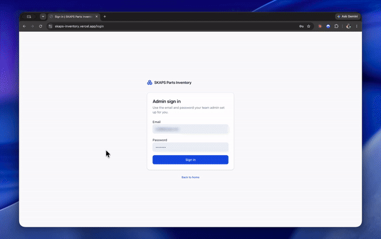
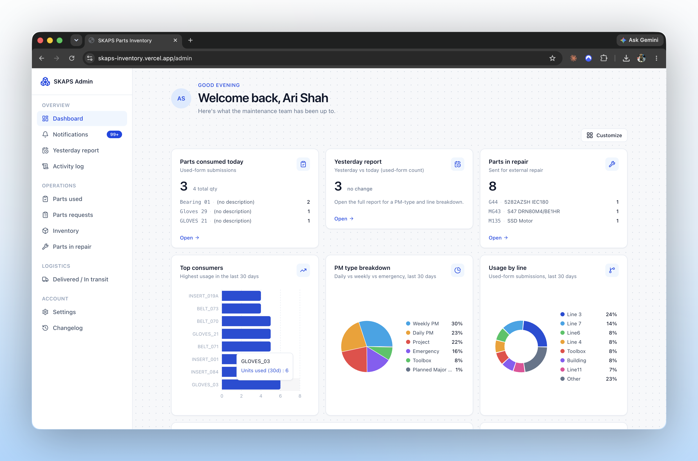
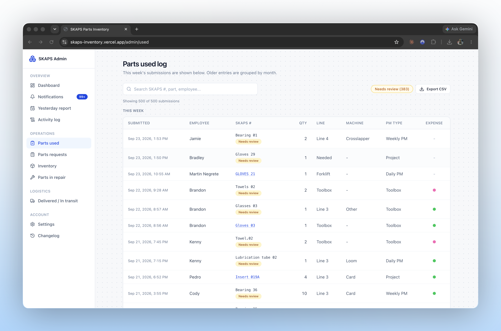
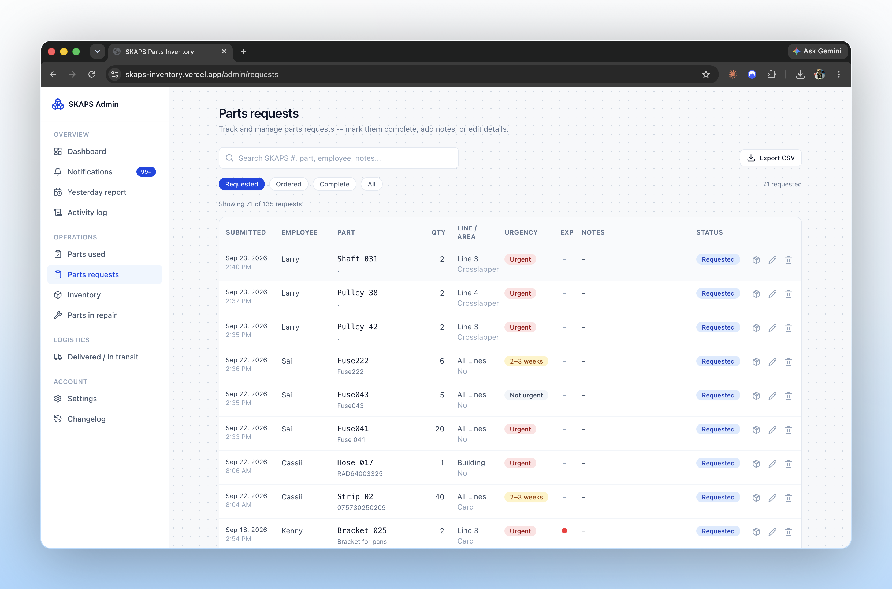
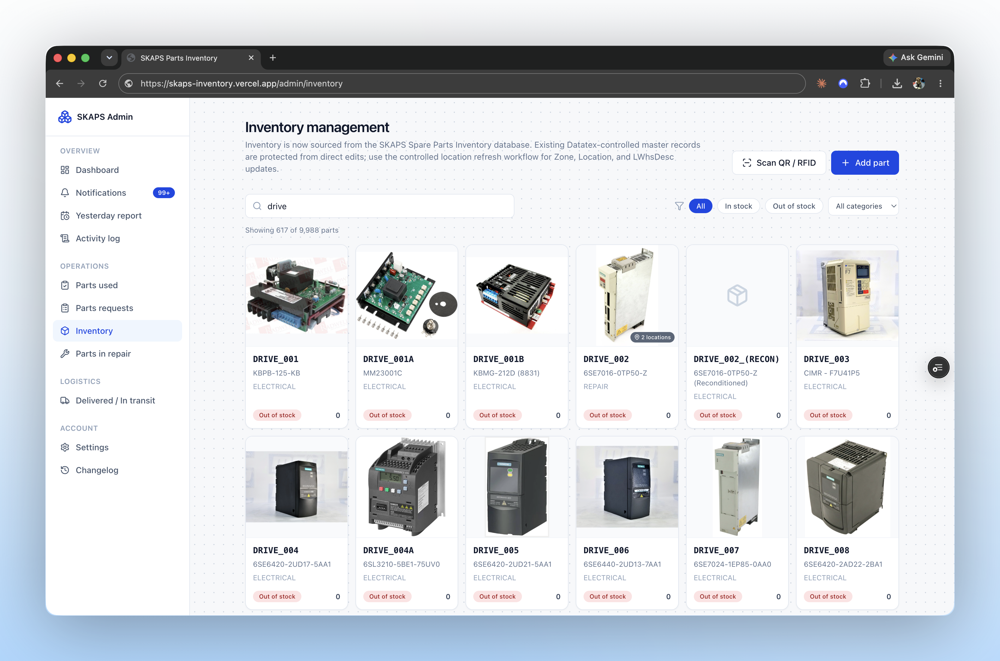
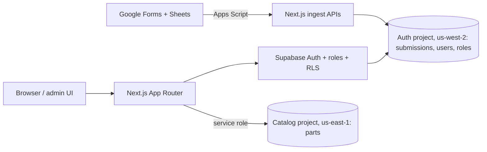
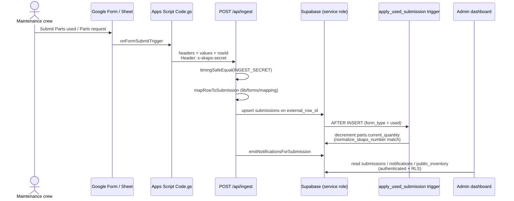

<div align="center">

# PartSync

**A production inventory dashboard that turns the SKAPS maintenance team's Google Forms into accurate shelf stock and an admin workflow.**


</div>




**Tech:** TypeScript · Next.js 15 · React 19 · Supabase (Postgres, Auth, RLS) · Google Apps Script · Tailwind · Vercel

---

## Overview

SKAPS' maintenance crew logs the parts they use and the parts they need through two bilingual Google Forms that all land in one spreadsheet. Keeping shelf counts accurate off that sheet is the hard part: it mixes both form types across ~48 columns, crews type the same part number a dozen different ways, and expense status is tracked by highlighting rows instead of filling in a field.

PartSync reads those rows, cleans them up, writes them to a real database, updates stock automatically, and gives admins a dashboard to work from. I built and shipped it solo as a freelance project, and the SKAPS team uses it daily.

## Features

**Crew keeps using the Google Forms they already know.** No new accounts, no retraining. The app handles the messy spreadsheet side behind the scenes.

**Shelf stock updates itself.** When a "parts used" row comes in, the quantity is decremented inside Postgres, so a retry or an app bug can't leave a count in a broken state.

**Messy input becomes clean records.** Bilingual headers and inconsistent part numbers get normalized before anything reaches the database. Anything that can't be matched gets flagged for review instead of silently disappearing.

**One place for admins to work.** Inventory, request pipeline, used log, repairs, notifications, and settings all live behind sign-in.

**Two roles, enforced in the database.** Admins get everything; staff get day-to-day operations without the activity log, staff invites, or catalog-wide writes like creating parts and bulk imports. The UI hides what a role can't do, the server re-checks it, and RLS enforces it independently.

**Expense colors carry over.** Row highlight colors from the spreadsheet sync into the app, so nobody has to add a new form field.

## Tech Stack

| Layer | Technology | Notes |
| ----- | ---------- | ----- |
| App framework | [Next.js 15](https://nextjs.org/) (App Router) | Server Components, Route Handlers, Server Actions. |
| UI | [React 19](https://react.dev/) + [Tailwind CSS v4](https://tailwindcss.com/) + Radix/shadcn-style `components/ui` | Admin/public UI, forms, dialogs, charts chrome. |
| Language | [TypeScript](https://www.typescriptlang.org/) | Strict app + `lib/supabase/types.ts` for DB types. |
| Database / auth | [Supabase](https://supabase.com/) (Postgres, Auth, Storage, RLS) | Two projects: auth/submissions/roles, and the parts catalog. Tables, triggers, RPCs, a materialized view, avatar bucket; cookie session via `@supabase/ssr`. |
| Charts | [Recharts](https://recharts.org/) | Dashboard usage widgets. |
| Drag-and-drop | [@dnd-kit](https://dndkit.com/) | Customizable admin dashboard grid layout. |
| Validation / forms | [Zod](https://zod.dev/) + [React Hook Form](https://react-hook-form.com/) | Admin CRUD forms. |
| Sheet bridge | [Google Apps Script](https://developers.google.com/apps-script) | Form ingest, row-color expense sync, master-list edits. |
| Hosting | [Vercel](https://vercel.com/) + [Supabase Cloud](https://supabase.com/) | Production app + database; `@vercel/analytics` in root layout. |

## Screenshots

**Admin dashboard** — configurable widget grid


**Parts used log** — expense status pulled from spreadsheet row colors


**Parts requests** — Requested → Ordered → Complete pipeline


**Inventory** — parts, quantities, and warehouse locations


## Architecture



The catalog lives in its own Supabase project with no browser access at all — it is reachable only from the server with the service-role key, so its authorization boundary is the app's role checks rather than RLS.

## Engineering Decisions

**Mapping columns by header name, not position.** The responses sheet mixes two form types across roughly 48 columns, and those columns have shifted around as the sheet grew. Hard-coding column indexes would have meant ingest breaking every time someone rearranged something. Instead, `lib/forms/mapping.ts` recognizes bilingual headers and grabs the first populated column that matches, so the sheet can drift without taking sync down with it.

**Getting accurate stock out of inconsistent part numbers.** Crews will type the same part as `insert 164` one day and `INSERT_164` the next. Matching on the raw string alone would quietly miss stock updates. I put a shared `normalize_skaps_number` function in both Postgres and TypeScript, and moved stock changes into an `AFTER INSERT` trigger that floors quantity at zero. Part lookup then works in layers: exact match first, then an RPC, then a normalized scan, then fuzzy suggestions. Rows that still don't match get marked `needs_review` and raise a notification rather than failing silently.

**Per-user notification read state.** The first version used a single global `read_at` field, which meant one admin marking something read cleared it for everyone. I added a `notification_reads` junction table and an `unread_notification_count()` function so each admin keeps their own unread state.

**Roles in their own table, with no write policies.** Putting `role` on `profiles` would have been the obvious move, but users are allowed to update their own profile row — which would have let anyone promote themselves from the browser. Roles live in `user_roles` instead, which has a read-your-own-row policy and *no* insert, update, or delete policies at all. Granting a role is a service-role operation, so it can only happen from a developer script or the Supabase dashboard. Unrecognized or missing role values fall back to the least privileged role rather than the most.

**Serving a 10k-part catalog without re-deriving it every time.** The catalog view was nested four levels deep, so Postgres rebuilt the whole thing for every query — and four pages each loaded all ~10,000 parts on every render. Flattening the list columns into a materialized view and caching the result behind a tag that write paths invalidate took it from ~2.5s to a read that touches the database only after a write or a 5-minute backstop.

**Keeping the list in tuple form, and being honest about why.** With ~10,000 rows the repeated JSON field names are bigger than the data itself: 4.23MB as objects versus 2.00MB as arrays. The obvious conclusion — that this halves what users download — is wrong, and measuring said so. Brotli already collapses repeated field names, so on the wire it is 458kB versus 424kB, a 7% difference. The change is still worth keeping, but for the reasons that survived measurement: ~2MB less JSON to parse and hold in memory on a phone, and a cache entry that fits under Vercel's 2MB per-entry limit. The uncompressed number was never the number users felt.

## Results

- Replaced the manual spreadsheet reconciliation the maintenance team was doing by hand
- Running in production and used daily by SKAPS staff
- Tracks roughly 9,000 parts and over 10,000 form submissions to date
- Catalog load went from ~2.5s to ~0.5s on a cache miss, and no database work at all on a hit
- Inventory page transfer is ~424kB brotli; the uncompressed payload dropped from 8.5MB to ~1.8MB, which is what the browser has to parse and hold

## What's Next

- Finish the Delivered / In transit admin UI. The page exists as a placeholder, and the `status`, `po_number`, and `received_at` fields already exist on `submissions`, so it's UI work rather than schema work.
- Consider consolidating regions. Functions run in `pdx1` and auth is in `us-west-2` (same metro, so session checks are cheap), while the catalog sits in `us-east-1`. Now that the catalog is cached, moving the *functions* east would make things worse — the win, if it's worth it, is moving the catalog west to join the other two.
- Decide whether repair tracking should affect shelf quantity. Right now `parts_in_repair` is intentionally decoupled.

<details>
<summary><b>Technical deep dive</b></summary>

**Core mechanic:** Forms stay the source of truth for field entry; Google Apps Script POSTs to Next.js ingest routes; Supabase stores `parts` / `submissions` and applies stock changes.

### Ingest sequence



### Architecture notes

- **Authorization is checked three times, on purpose.** The UI hides what a role can't do (`can()` in `lib/auth/permissions.ts`), server actions re-check it (`requirePermission` / `requirePagePermission` in `lib/auth/roles.ts`), and RLS enforces it in the database via `is_admin()`. The three must be kept in step; the client-side check is cosmetic and never the boundary.
- **The catalog project has no browser access by design.** It holds no users and no RLS-protected surface — nothing in it is readable by `anon` or `authenticated`. Every read and write goes through the server with the service-role key, which is why inventory writes are gated by `requirePartSyncPermission()` before the client is ever constructed.
- **RLS is the authorization boundary on the auth project.** anon cannot read `parts` / `public_inventory` after `0011_restrict_inventory_anon_access.sql`; middleware and `app/admin/layout.tsx` redirects are UX only.
- **Stock changes run in Postgres, not the API.** If quantity math ran in application code, a retried request or a bug could double-count or push stock negative. `trg_apply_used_submission` / `apply_used_submission()` floors quantity at zero and matches on `normalize_skaps_number`, making the database the single enforcer.
- **Ingest auth is a shared secret with constant-time compare.** `/api/ingest`, `/api/ingest-master`, and `/api/sync-expense-status` require `x-skaps-secret` vs `INGEST_SECRET` via `timingSafeEqual`; writes use the service-role client and bypass RLS.
- **Idempotent sheet sync.** submissions upsert on `external_row_id`; master-list variants upsert on their own `external_row_id`.
- **SKAPS resolution is layered.** exact match → `find_part_by_skaps_number` RPC → in-memory normalized scan → fuzzy suggestions; unmatched used rows get `status = needs_review` and an `unknown_skaps` notification.
- **Multi-warehouse locations without splitting stock identity.** shared fields on `parts`; warehouse/zone rows on `part_variants` (`0007_part_variants.sql`), synced from the Athens master sheet via `/api/ingest-master`.

### Route map

| Area | Routes |
| ---- | ------ |
| Public | `/`, `/forms`, `/inventory` (auth required), `/changelog` |
| Auth | `/login`; session refresh in `lib/supabase/middleware.ts`; staff invites from `/admin/settings` |
| Admin (any role) | `/admin` (widget grid), `/admin/notifications`, `/admin/used`, `/admin/requests`, `/admin/inventory`, `/admin/repair`, `/admin/reports/yesterday`, `/admin/settings`, `/admin/changelog` |
| Admin only | `/admin/audit`, `/admin/inventory/new`; plus Excel import, repair delete, and staff invites as actions |
| Ingest / sync | `POST /api/ingest`, `POST /api/ingest-master`, `POST /api/sync-expense-status` |
| Placeholder | `/admin/delivered` (`status` / `po_number` / `received_at` already on `submissions`) |

Admin-only pages 404 rather than redirect, so their existence isn't advertised to staff. Nav items filter themselves by permission in `components/nav/admin-nav-config.ts`.

### Project structure

```text
PartSync/
├── app/
│   ├── (public)/          # Home, /forms, /inventory, /changelog
│   ├── admin/             # Dashboard, logs, inventory, repair, settings, audit
│   ├── api/               # ingest, ingest-master, sync-expense-status
│   ├── auth/callback/     # Supabase auth callback
│   └── login/             # Admin sign-in
├── components/            # UI, dashboard widgets, nav, inventory, requests, repair
├── lib/
│   ├── auth/              # Role + permission map, server-side gates
│   ├── forms/             # Header mapping, normalize, ingest notifications
│   ├── inventory/         # SKAPS match, stock helpers, master-list map
│   ├── inventory-backend/ # Catalog project: service client, loaders, cache
│   ├── supabase/          # Clients, env, types, fetch-all
│   ├── dashboard/         # Widget catalog + server widgets
│   ├── audit/             # Admin action logging
│   ├── notifications/     # Read-state helpers
│   └── perf.ts            # Timing + payload logging, gated on PERF_LOGS
├── scripts/               # Perf measurement, SKAPS matching parity check
├── supabase/
│   ├── migrations/            # Auth project: schema, RLS, triggers, RPCs
│   ├── inventory-migrations/  # Catalog project: matview, refresh, read RPCs
│   └── seed/                  # Account management + one-off import scripts
├── docs/apps-script/      # Bound Apps Script sources for the live sheets
└── middleware.ts          # Session refresh; protect /admin and /inventory
```

The two migration directories target **different Supabase projects** and are applied separately — each file names its target in a header comment.

### Security

| Mechanism | Where |
| --------- | ----- |
| Supabase Auth (email/password) | `/login`, `app/login/actions.ts`, cookie session via `@supabase/ssr` |
| Route gate for `/admin/**` and `/inventory` | `lib/supabase/middleware.ts` + `app/admin/layout.tsx` `getUser()` |
| Admin/staff roles | `user_roles` + `is_admin()` (`0021_user_roles.sql`); `lib/auth/roles.ts` server gates; `lib/auth/permissions.ts` capability map |
| Self-promotion prevented | `user_roles` has a read-own-row policy and **no** write policies; granting a role is service-role only |
| New accounts default to least privilege | `handle_new_user()` inserts `staff`; `toAppRole()` falls back to `staff` on anything unexpected |
| Catalog project unreachable from browsers | No `anon` / `authenticated` grants on any table, view or function; server-only service-role access |
| RLS on tables/views | `supabase/migrations/0002_rls.sql` and later migrations; anon SELECT revoked on inventory in `0011` |
| Service role only on trusted server paths | `createServiceClient()` in ingest routes, never from client components |
| Shared-secret header for Apps Script | `x-skaps-secret` vs `INGEST_SECRET` with `timingSafeEqual` |
| Profile self-update; broader profile read for audit/avatars | `profiles` policies in `0002` / `0016` |
| Append-only audit trail | `audit_log` insert-as-self, no update/delete policies (`0017`) |
| Avatar storage policies | `0018_avatars_storage.sql` |

</details>

<details>
<summary><b>Run it locally</b></summary>

### Prerequisites

- Node.js (compatible with Next.js 15)
- Two [Supabase](https://supabase.com/) projects: the **auth** project with `supabase/migrations/` applied, and the **catalog** project with `supabase/inventory-migrations/` applied
- An admin account, created with `supabase/seed/create_user.ts` (see below) — public sign-up is disabled
- (Optional) Google Apps Script bound to the live sheets, see `docs/apps-script/SETUP.md`

### Setup

```bash
git clone https://github.com/ar1shah/PartSync.git
cd PartSync
cp .env.example .env.local   # fill in keys (names below)
npm install                  # or pnpm install
npm run dev                  # next dev --turbopack
```

### Required env var names

From `.env.example`:

Auth project:

- `NEXT_PUBLIC_SUPABASE_URL`
- `NEXT_PUBLIC_SUPABASE_ANON_KEY`
- `SUPABASE_SERVICE_ROLE_KEY`

Catalog project (server-only — deliberately not `NEXT_PUBLIC_`):

- `SKAPS_INVENTORY_SUPABASE_URL`
- `SKAPS_INVENTORY_SUPABASE_SERVICE_ROLE_KEY`

Shared:

- `INGEST_SECRET`
- `NEXT_PUBLIC_GFORM_USED_URL` (optional for local UI)
- `NEXT_PUBLIC_GFORM_REQUEST_URL` (optional for local UI)
- `NEXT_PUBLIC_SITE_URL` (optional locally; defaults example uses `http://localhost:3000`)

### Useful scripts

| Script | Command |
| ------ | ------- |
| `npm run dev` | Start Next.js with Turbopack |
| `npm run build` / `npm start` | Production build and serve |
| `npm run lint` | ESLint |
| `npm run typecheck` | `tsc --noEmit` |
| `npm run format` / `format:check` | Prettier |
| `npm run perf:baseline` | Time the catalog load and print payload sizes |
| `npm run verify:skaps` | Parity check for SKAPS link matching, including ambiguous keys |
| `npm run import:historical` | One-off historical import (`tsx supabase/seed/import_historical.ts`) |

Accounts are managed with `supabase/seed/create_user.ts`, since public sign-up is disabled and the app can only invite staff:

```bash
pnpm tsx supabase/seed/create_user.ts create <email> <first> <last> --role admin
pnpm tsx supabase/seed/create_user.ts set-role <email> staff
pnpm tsx supabase/seed/create_user.ts delete <email>
```

Set `PERF_LOGS=1` to turn on timing and payload-size logging; it is a no-op otherwise.

</details>

---

Built for the SKAPS maintenance team and running in production. The live app is only accessible to SKAPS staff, so the demo above and the screenshots are the best look at it. This repo is public for portfolio context.

Ari Shah · [Portfolio](https://www.ar13.dev/)

MIT License, see [LICENSE](LICENSE).
